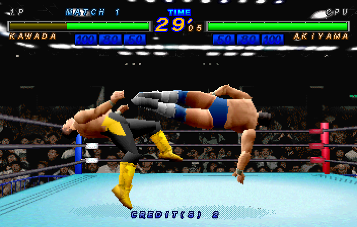
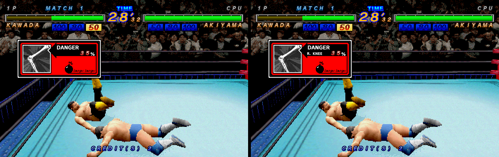
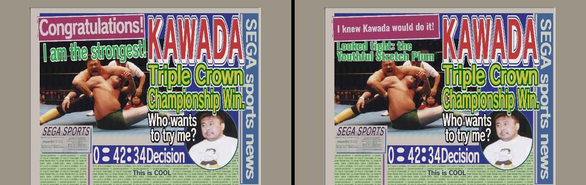
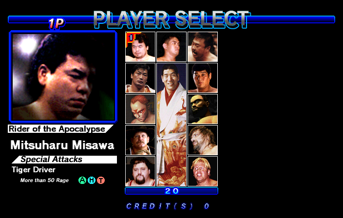
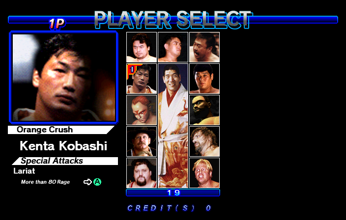

# All Japan Pro-Wrestling Featuring Virtua — English translation (Sega ST-V)

An English translation of the Sega ST-V game **Zen Nippon Pro-Wres Featuring Virtua** (1997), built as a new ROM set: `znpwfve`.

The game already has an English mode. The Taiwan release (`znpwfvt`) uses the same graphics ROMs as the Japanese one, and the language follows the BIOS region. But Sega left part of the game in Japanese, or blank, even in English mode. This set starts from the Taiwan program and redraws what was missing. The title screen uses the official English logo of the Taiwan release.

## Support
Hey dude! Help me out for a couple of :beers: or a :coffee:!<br/>
[](https://bmc.link/zanac)

## What is translated

**Left in Japanese or blank by the official English mode**

| Where | Japanese | English |
|---|---|---|
| Player select, Hiroshi Hase | 北斗の流星 / 馳 浩 / ノーザンライトスープレックス | Meteor of the Big Dipper / Hiroshi Hase / Northern Lights Suplex, Ⓗ (Grab!) Ⓣ |
| Player select, The Patriot | 愛国戦士 / パトリオット / フルネルソンバスター / 闘気80以上・背後から | Patriotic Warrior / The Patriot / Full Nelson Buster / More than 80 Rage · From Behind ⒷⒸ |
| VS screen | プレイヤー / 馳 浩 / パトリオット | Player / Hiroshi Hase / The Patriot |
| DANGER panel in the match | クビ / 右ヒジ / 左ヒジ / 腰 / 右ヒザ / 左ヒザ | NECK / R. ELBOW / L. ELBOW / BACK / R. KNEE / L. KNEE |
| Data panel | 本体RAM / カートリッジRAM | System RAM / Cartridge RAM |
| Password panel | パスワードが正しく入力されませんでした。 / パスワード入力OKです。 | The password was not entered correctly. / Password accepted. |

**Victory newspapers.** The English mode gives every wrestler the same generic lines ("I am the strongest!", "Congratulations!"). The Japanese newspapers have a different joke for each wrestler. This set puts a translation of the Japanese lines back:

| Wrestler | Photo headline | Banner |
|---|---|---|
| Wolf Hawkfield | His howl echoes through the arena | Even his karaoke is getting better! |
| Jeffry McWild | Will he go pro wrestler for good? | This might pay better than fishing, Jeff! |
| Mitsuharu Misawa | A trade fair of incredible moves | The packed crowd held its breath! |
| Kenta Kobashi | Kobashi Kobashi Kobashi Kobashi Kobagi~ | We've been waiting for this moment! |
| Toshiaki Kawada | Locked tight: the Youthful Stretch Plum | I knew Kawada would do it! |
| Akira Taue | Anyone at all: a storm of throat chops | Is this Taue? He's a different man! |
| Giant Baba | Even Misawa, like a carp... | Sure to top this year's 10 biggest news! |
| Jun Akiyama | Does he have a grudge against Kawada? | Rising fast, now a threat to those above! |
| Stan Hansen | It's not just the lariat, you know | Burning Texas spirit explodes! |
| Steve Williams | A real bargain sale of fierce fights | With this, I could quit being a killer (doctor)! |
| Johnny Ace | Shorter hair, lighter moves | Somebody stop Ace! |
| Gary Albright | Right after this, that terrifying suplex show began. | Anyone who objects, step up. I'm the strongest! |

The photo behind each new headline is restored from the Japanese newspaper, which has the same photo without the English line.

## Screenshots



*A match in `znpwfve`.*

Official Taiwan release `znpwfvt` (English mode) on the left, `znpwfve` on
the right:

| | |
|---|---|
| DANGER panel: the body part was left blank |  |
| Victory newspaper: generic lines replaced by the Japanese joke |  |

Hiroshi Hase and The Patriot in `znpwfve` (blank or in Japanese in the
official English mode):

| | |
|---|---|
|  |  |

## Building the ROM set

Requirements: Python 3, standard library only.

Inputs, in one folder:
- `znpwfv.zip`, the Japanese set.
- The Taiwan program `epr20408.13`, either in `znpwfvt.zip` or inside a merged `znpwfv.zip` (as `znpwfvt/epr20408.13`).

```
python3 patch/make_znpwfve.py /path/to/roms [/path/to/output]
```

The script finds the ROMs by CRC (the names inside the zips do not matter)
and checks every result.

Input:

| File | Size | CRC32 | SHA1 | From |
|---|---|---|---|---|
| epr20408.13 | 1048576 | 1d62fcf6 | 3651261aa755da27b11462f2705311b7c639a687 | `znpwfvt` (Taiwan program) |
| mpr20406.9 | 4194304 | b677c175 | d0de7b5a29928036df0bdfced5a8021c0999eb26 | `znpwfv` |
| mpr20407.10 | 4194304 | 58356050 | f8fb5a14f4ec516093c785891b05d55ae345754e | `znpwfv` |

Output, the files of `znpwfve.zip` after the patch:

| File | Size | CRC32 | SHA1 | Replaces |
|---|---|---|---|---|
| epr20408.13 | 1048576 | 1d62fcf6 | 3651261aa755da27b11462f2705311b7c639a687 | unchanged, Taiwan program |
| znpe20406.9 | 4194304 | b73ccd2c | 75b6d5c568ed5baf594b186db782e7e9af55205b | mpr20406.9 |
| znpe20407.10 | 4194304 | d15eb928 | 5217ec91daca0d9b5bc56a904ea09765567598d5 | mpr20407.10 |

The other ROMs are shared with the parent `znpwfv`. The game needs `stvbios.zip` with the Taiwan BIOS (`epr-17953a.ic8`).

## Running it

The set is defined in the [mame2003-plus libretro core](https://github.com/zanac/mame2003-plus-libretro), branch `stv-znpwfv-english` (on top of the ST-V driver from current MAME). The core selects the Taiwan BIOS for it on its own. Put `znpwfve.zip`, `znpwfv.zip` and `stvbios.zip` in the same folder.

## Rebuilding the patch

`tools/` holds the scripts that made the graphics. They rebuild `patch/znpwfve.dat` from the original ROMs, byte for byte:

```
pip install numpy pillow opencv-python
python3 tools/build_patch.py /path/to/znpwfv.zip
```

How it works:
- The graphics files of the cartridge are read and rewritten in place, so no file moves. Only the last two mask ROMs change.
- Profile panels and the VS names reuse the game's own letters (traced from the existing English profiles and names). Missing letters such as `P` are built from existing ones.
- The newspaper photos are rebuilt from the Japanese newspapers, shifted to match. The new lines are drawn in Oswald.
- Every redrawn screen keeps the original number of cells, so nothing grows in video memory.

Fonts in `fonts/`: Oswald (SIL Open Font License 1.1) and DejaVu Sans (Bitstream Vera license). Their licenses are in the same folder.

## Credits

Translation hack by Vanni Brutto. The game is © Sega 1997; the characters are licensed by All Japan Pro-Wrestling. This repository holds no game data, only a difference against the original ROMs and the tools that made it.
